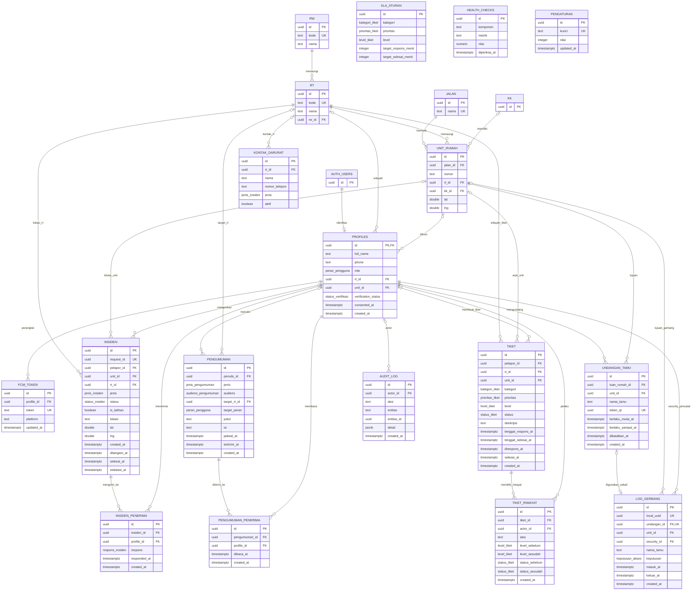
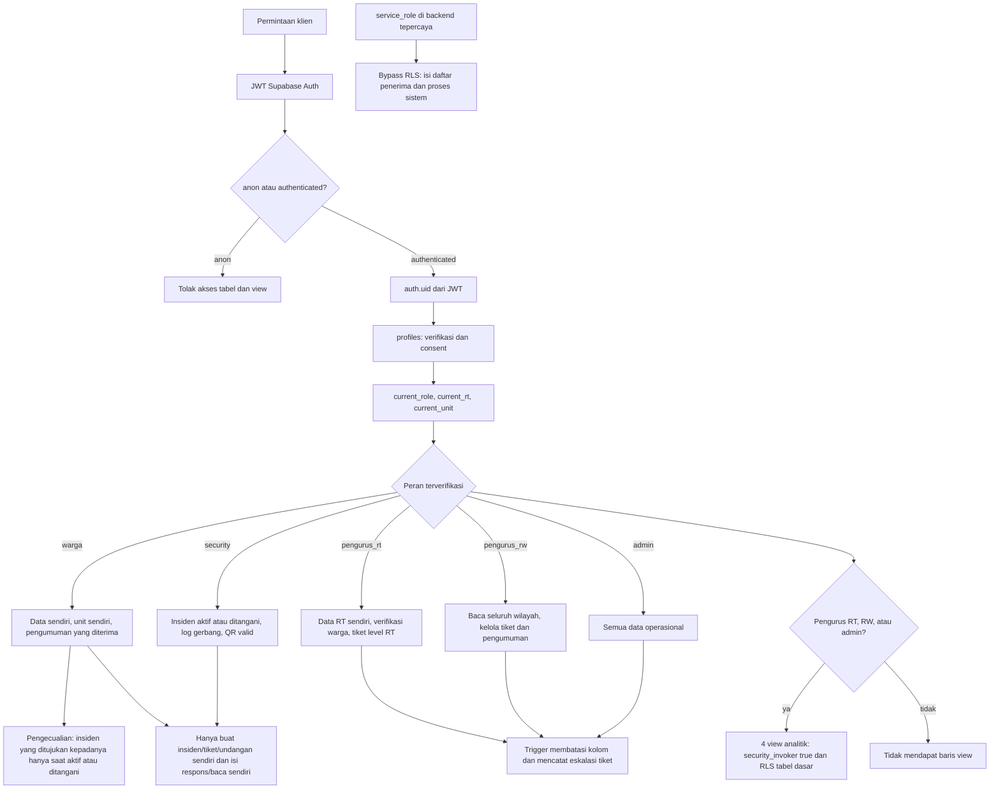

# Skema Wesbar (Supabase/PostgreSQL)

Migrasi dijalankan berurutan: `0001_wilayah.sql` s.d. `0015_ticket_submission.sql`. Seluruh PK tabel adalah UUID; seluruh waktu memakai `timestamptz`. Tidak ada nomor KK, NIK, atau data biometrik. `kk` berisi **ID internal saja**; beberapa `unit_rumah` dapat menunjuk `kk.id` yang sama. Kolom `*_id` adalah FK kecuali `local_uuid` (kunci idempotensi log gerbang), `request_id` (kunci idempotensi alert), dan `entitas_id` pada audit (referensi generik tanpa FK).

## Tabel dan relasi

| Tabel | Kolom (selain `id` UUID) | Relasi / aturan utama |
|---|---|---|
| `rw` | `kode`, `nama` | Wilayah RW; deployment awal hanya memuat RW 5 dan dapat dibaca akun terverifikasi. |
| `rt` | `kode`, `nama`, `rw_id` | `kode` unik; FK → `rw`. Seluruh RT pada cakupan awal ditautkan ke RW 5. |
| `jalan` | `nama` | `nama` unik; satu jalan dapat meliputi beberapa RT. |
| `kk` | — | Hanya ID internal; tidak menyimpan nomor KK. |
| `unit_rumah` | `jalan_id`, `nomor`, `rt_id`, `kk_id?`, `lat?`, `lng?` | FK → `jalan`, `rt`, `kk`; melalui RT, rumah terhubung ke RW. Pasangan jalan–nomor unik. Koordinat opsional, dipakai untuk tetangga/radius jika tersedia. |
| `profiles` | `full_name`, `phone?`, `role`, `rt_id?`, `unit_id?`, `verification_status`, `consented_at`, `created_at` | `id` FK → `auth.users`; `rt_id` → `rt`, `unit_id` → `unit_rumah`. Warga wajib punya unit dan RT yang cocok. Hanya profil terverifikasi dapat memperoleh akses berdasarkan peran. Pengurus RT dapat mengoreksi nama/rumah warga di RT-nya; admin dapat mengelola seluruh wilayah. |
| `fcm_token` | `profile_id`, `token`, `platform`, `updated_at` | FK → `profiles`; token unik. |
| `insiden` | `request_id`, `pelapor_id?`, `unit_id?`, `rt_id`, `jenis`, `status`, `is_latihan`, `lokasi`, `lat?`, `lng?`, `created_at`, `ditangani_at?`, `selesai_at?`, `eskalasi_at?` | `request_id` unik untuk retry offline tanpa duplikasi; FK → `profiles`, `unit_rumah`, `rt`; penerima ditetapkan oleh RPC `create_insiden`. |
| `insiden_penerima` | `insiden_id`, `profile_id`, `respons`, `responded_at?`, `created_at` | FK → `insiden`, `profiles`; pasangan insiden–penerima unik. Respons sendiri dicatat sekali. |
| `kontak_darurat` | `rt_id?`, `nama`, `nomor_telepon`, `jenis?`, `aktif` | FK → `rt`; RT kosong berarti kontak umum. |
| `pengumuman` | `penulis_id?`, `jenis`, `audiens`, `target_rt_id?`, `target_peran?`, `judul`, `isi`, `jadwal_at?`, `terkirim_at?`, `created_at` | FK → `profiles`, `rt`; target harus cocok dengan `audiens`. |
| `pengumuman_penerima` | `pengumuman_id`, `profile_id`, `dibaca_at?`, `created_at` | FK → `pengumuman`, `profiles`; pasangan pengumuman–penerima unik. Penerima hanya melihat pengumuman setelah `terkirim_at` terisi. |
| `sla_aturan` | `kategori`, `prioritas`, `level`, `target_respons_menit`, `target_selesai_menit` | Kombinasi kategori–prioritas–level unik; bila aturan belum disepakati, tiket tetap dapat dibuat dengan tenggat respons/selesai `NULL`. |
| `tiket` | `pelapor_id?`, `rt_id`, `unit_id?`, `kategori`, `prioritas`, `level`, `status`, `deskripsi`, `foto_path?`, `tenggat_respons_at?`, `tenggat_selesai_at?`, `direspons_at?`, `selesai_at?`, `created_at` | FK → `profiles`, `rt`, `unit_rumah`; trigger mengisi tenggat bila aturan SLA tersedia. Foto opsional berada di bucket privat `ticket-photos`; akses mengikuti pelapor dan pengurus wilayah. Eskalasi `rt → rw` mempertahankan tenggat asli. |
| `tiket_riwayat` | `tiket_id`, `actor_id?`, `aksi`, `level_sebelum?`, `level_sesudah?`, `status_sebelum?`, `status_sesudah?`, `created_at` | FK → `tiket`, `profiles`; trigger mencatat pembuatan, perubahan status, dan **setiap** perubahan level RT→RW. Tidak dapat ditulis langsung oleh klien; FK `RESTRICT` mencegah penghapusan tiket beserta riwayatnya lewat API. |
| `undangan_tamu` | `tuan_rumah_id`, `unit_id`, `nama_tamu`, `token_qr`, `berlaku_mulai_at`, `berlaku_sampai_at`, `dibatalkan_at?`, `created_at` | FK → `profiles`, `unit_rumah`; token QR UUID acak unik, tanpa informasi tamu di dalam token. |
| `log_gerbang` | `local_uuid`, `undangan_id?`, `unit_id?`, `security_id`, `nama_tamu?`, `keputusan`, `masuk_at?`, `keluar_at?`, `created_at` | FK → `undangan_tamu`, `unit_rumah`, `profiles`; `local_uuid` unik untuk sinkronisasi offline, undangan sekali pakai. Tamu tanpa undangan dapat dicatat tanpa `undangan_id`. |
| `audit_log` | `actor_id?`, `aksi`, `entitas`, `entitas_id?`, `detail`, `created_at` | FK aktor → `profiles`; jangan isi `detail` dengan data pribadi/rahasia. Append-only untuk klien. |
| `health_checks` | `komponen`, `metrik`, `nilai`, `diperiksa_at` | Pengukuran yang dicatat admin atau backend tepercaya. |
| `pengaturan` | `kunci`, `nilai`, `updated_at` | Kunci unik: `radius_tetangga_m`, `batas_eskalasi_detik`, `retensi_hari`. Belum dibuat job terjadwal. |

Migrasi `0014_rw5_scope.sql` membuat data induk RW 5 dan menautkan seluruh RT yang sudah ada ke RW tersebut; tabel RW bersifat baca-saja bagi klien. Migrasi `0015_ticket_submission.sql` menambahkan bukti foto privat opsional untuk tiket; aplikasi membatasi foto 5 MB dan hanya JPG, PNG, atau WebP. `?` menandakan nullable. FK eksplisit memakai `ON DELETE CASCADE`, `SET NULL`, atau `RESTRICT` sesuai migrasi. `auth.users` sudah disediakan Supabase. `auth.uid()` diperoleh dari token pengguna, bukan input klien. Fungsi `resolve_registration_unit` (`0010`) menerima kode RT, nama jalan, dan nomor rumah yang tepat dari pengguna **yang sudah masuk** dan hanya mengembalikan ID RT/unit untuk pendaftaran; kecocokan alamat bukan bukti bahwa pendaftar adalah penghuninya, sehingga verifikasi pengurus RT tetap wajib. RPC `create_insiden` (`0011`) memvalidasi warga terverifikasi, membatasi tiga alert per lima menit, dan mengisi penerima security, pengurus, serta warga terdekat. Jika koordinat rumah pelapor belum ada, penerima warga di-fallback ke warga satu RT.

## Matriks akses RLS

`O` = baca milik sendiri/ditugaskan, `R` = baca data dalam RT, `W` = baca seluruh wilayah, `T` = tulis yang diizinkan; `—` = tidak ada akses. Tulis tetap tunduk pada trigger (misalnya warga tidak boleh mengubah `role`). Semua tabel mengaktifkan RLS; `anon` tidak diberi hak. `service_role` hanya untuk backend tepercaya dan melewati RLS.

| Tabel | Warga | Security | Pengurus RT | Pengurus RW | Admin |
|---|---|---|---|---|---|
| `rw` | O baca untuk akun terverifikasi | O baca | O baca | O baca | O baca |
| `rt`, `jalan`, `kk`, `unit_rumah` | O | — | R | W | W/T |
| `profiles` | O/T kontak sendiri, daftar | O/T kontak sendiri | R/T verifikasi dan koreksi nama/rumah warga di RT sendiri | W baca | W/T |
| `fcm_token` | O/T | O/T | O/T sendiri | O/T sendiri | W/T |
| `insiden` | O/T buat; O jika penerima saat aktif | W aktif/T status | R/T status | W/T status | W/T |
| `insiden_penerima` | O/T respons sendiri, atau baca sebagai pelapor | O/T respons sendiri | R baca | W baca | W/T |
| `kontak_darurat` | O/R baca | — | R/T | W baca | W/T |
| `pengumuman` | O baca setelah dikirim | O baca jika penerima | R/T milik sendiri | W/T milik sendiri | W/T |
| `pengumuman_penerima` | O/T waktu baca | O/T waktu baca | R baca | W baca | W/T |
| `sla_aturan` | W baca | — | W baca | W baca | W/T |
| `tiket` | O/T buat | — | R/T saat level RT | W/T | W/T |
| `tiket_riwayat` | O baca | — | R baca | W baca | W baca |
| `undangan_tamu` | O/T | W baca saat valid | R baca | W baca | W/T |
| `log_gerbang` | O baca menurut unit | W/T | R baca | W baca | W/T |
| `audit_log` | — | — | — | — | W baca/tambah |
| `health_checks`, `pengaturan` | — | — | — | — | W/T |

Petugas security tidak dibatasi jam shift pada tahap ini. Ia dapat melihat insiden berstatus `aktif`/`ditangani`, menutupnya lewat perubahan status, dan melihat/mencatat log gerbang. Akses profil/token sendiri serta pengumuman yang ditujukan kepadanya merupakan pengecualian operasional. Admin dapat mengelola seluruh data operasional; `tiket_riwayat` dan `audit_log` sengaja tidak dapat diubah/dihapus lewat API agar jejaknya tetap utuh. Penugasan penerima insiden/broadcast dilakukan admin atau backend `service_role`, **bukan** langsung oleh warga.

## View

| View | Isi |
|---|---|
| `v_heatmap_jalan_jam` | Jumlah insiden nonlatihan/bukan alarm palsu dan tiket keamanan menurut RT, jalan, jam WIB. Tanpa unit tidak masuk pengelompokan jalan. |
| `v_kepatuhan_sla` | Jumlah tiket, respons sesuai tenggat, dan selesai sesuai tenggat menurut RT/kategori/prioritas. |
| `v_keterbacaan` | Jumlah penerima/dibaca/persentase per pengumuman yang sudah dikirim. Pada pengurus RT, hanya penerima yang terlihat menurut RLS terhitung. |
| `v_waktu_respons` | Rata-rata detik dari pembuatan insiden sampai respons pertama `menuju`, mengabaikan latihan/alarm palsu. |

View memakai `security_invoker = true` (memerlukan PostgreSQL 15+); hanya pengurus/admin yang mendapat baris. Jangan memakai view agregat dengan kelompok berisi satu orang/kejadian sebagai data publik. Nilai retensi/SLA, data RT, dan akun admin pertama harus disepakati serta diisi secara tepercaya; migrasi tidak membuat data warga contoh ataupun scheduler. `pg_cron`, FCM push ke layar terkunci, otomatisasi SMS/WhatsApp, dan penghapusan menurut retensi belum dibuat. M1 saat ini menggunakan notifikasi in-app Realtime; Edge Function `panic-create` menjadwalkan pengecekan eskalasi 60 detik secara best-effort. Migrasi `0001`–`0015` telah diterapkan ke project Supabase tertaut dan diverifikasi melalui `supabase migration list --linked`. `0013_profile_management.sql` mengizinkan pengurus RT mengoreksi nama/rumah warga di RT sendiri dan mencatat audit; `0014_rw5_scope.sql` membuat wilayah RW 5 serta menautkan seluruh RT yang ada; `0015_ticket_submission.sql` menambah foto tiket privat opsional. Kolom foto/tenggat dan bucket privat `ticket-photos` sudah diverifikasi pada remote. Saat ini `sla_aturan` masih kosong, jadi tenggat tiket bernilai `NULL` sampai aturan disepakati. Sebanyak 20 tabel ber-RLS; keempat view serta RPC M1 dan keanggotaan tabel Realtime sudah diverifikasi.

## Skrip diagram relasi (Mermaid ER)

Salin blok berikut ke renderer Mermaid atau lihat pratinjau Markdown. Ini menggambarkan **seluruh 20 tabel** dan FK; `AUTH_USERS` adalah tabel Supabase Auth eksternal, bukan tabel tambahan migrasi. Tipe `double` di diagram mewakili `double precision` pada SQL. Detail nullable, UNIQUE, `ON DELETE`, dan CHECK tetap mengacu ke migrasi serta tabel di atas; diagram bukan pengganti DDL.

`SLA_ATURAN` tidak memiliki FK langsung ke `TIKET`: aturan dicocokkan oleh trigger lewat kombinasi kategori–prioritas–level. `HEALTH_CHECKS` dan `PENGATURAN` tidak memiliki FK. `AUDIT_LOG.entitas_id` adalah UUID generik, **bukan** FK ke satu tabel.

## Skrip diagram alur RLS dan view (Mermaid)

Diagram berikut merangkum batas akses; **matriks per tabel di atas adalah rincian izin SELECT/INSERT/UPDATE/DELETE**. RLS diterapkan pada 19 tabel, sedangkan empat view memakai `security_invoker = true`. Tanda panah bukan relasi FK.

`profiles` sendiri tetap dapat dibaca saat verifikasi tertunda agar calon warga melihat statusnya, tetapi helper peran tidak mengembalikan hak operasional sampai terverifikasi. `tiket_riwayat` ditulis oleh trigger saja; `audit_log` hanya baca/tambah oleh admin. Security tidak dibatasi shift pada rancangan ini. Keempat view adalah `v_heatmap_jalan_jam` (dari `insiden`, `tiket`, `unit_rumah`), `v_kepatuhan_sla` (dari `tiket`), `v_keterbacaan` (dari `pengumuman`, `pengumuman_penerima`), dan `v_waktu_respons` (dari `insiden`, `insiden_penerima`).
